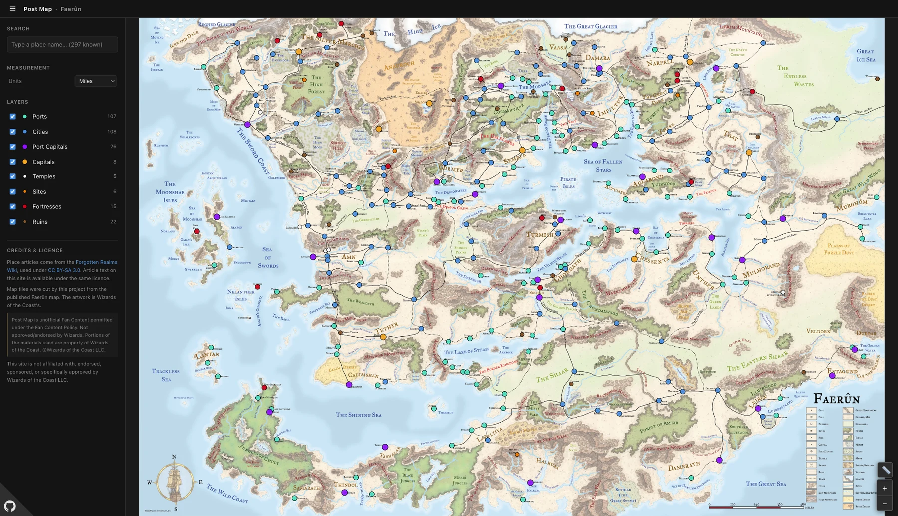

# Post Map

An interactive map of Faerûn for tabletop D&D — pan and zoom a tiled
3rd-edition map, find any of 297 marked places, measure travel distances, and
read that place's Forgotten Realms Wiki article without leaving the map.

**→ [postmap.findquinn.com](https://postmap.findquinn.com)**

[](https://github.com/nooikko/post-map/actions/workflows/ci.yml)
[](LICENSE)
[](https://company.wizards.com/en/legal/fancontentpolicy)

Not affiliated with, endorsed, or approved by Wizards of the Coast.



## Features

- **The whole of Faerûn**, tiled — smooth pan and zoom, no external tile service.
- **297 places** across eight categories — Capitals, Cities, Ports, Port
  Capitals, Fortresses, Ruins, Sites, and Temples — each toggleable.
- **Place articles** from the Forgotten Realms Wiki, in a panel beside the map,
  with the infobox laid out as readable fields rather than wiki table markup.
- **Distance measurement** in miles or kilometres, scaled from the source map.
- **Search** across every marked place.
- **Shareable links** — every place has its own URL.
- **Built for a finger too** — on touch the sidebar becomes a bottom sheet you
  drag down, and the map keeps the whole screen.
- **Nothing behind it** — every page is prerendered, so there is no database,
  no accounts, no cookies, and no runtime API calls beyond anonymous visitor
  counts. See [Privacy](PRIVACY.md).

## Getting started

Requires **Node.js 22.6+** and **pnpm**.

```bash
git clone https://github.com/nooikko/post-map.git
cd post-map
pnpm install
pnpm dev
```

Then open http://localhost:3000.

To build and serve the production site:

```bash
pnpm build
pnpm start
```

<details>
<summary>All available scripts</summary>

| Command | What it does |
|---|---|
| `pnpm dev` | Development server |
| `pnpm build` | Prerender the map and all 297 place pages |
| `pnpm start` | Serve the production build |
| `pnpm typecheck` | `tsc --noEmit` |
| `pnpm licence` | Regenerate `NOTICE`, `REUSE.toml` and `LICENSES/` from `lib/attribution.ts` and `lib/licence-scope.ts` |
| `pnpm licence:check` | Fail if any of those have drifted; CI runs this |
| `pnpm images` | Recompose `public/faerun-map*` from the tile pyramid |
| `pnpm fetch:redirects` | Top up the wiki mirror; `--force` re-fetches |

`licence` is a pair of narrower scripts — `notice` and `reuse`, each with a
`:check` variant — for when only one of the generated files is in question.

`images` is not part of the build. Its two outputs are committed alongside the
tiles they are cut from, so it only needs running when the pyramid changes.

</details>

## Documentation

- [Architecture](docs/architecture.md) — how the map, routing, and wiki pipeline
  fit together
- [Tile pipeline](docs/tile-pipeline.md) — how the map tiles were produced
- [Data schema](schemas/README.md) — the mirrored article format

## Contributing

Bug reports and ideas are welcome — please
[open an issue](../../issues). This is a personal project, so pull requests may
not be merged; see [CONTRIBUTING.md](CONTRIBUTING.md) before starting work on
one, and [the code of conduct](.github/CODE_OF_CONDUCT.md) for the short version
of how to behave.

To report a security issue, see [SECURITY.md](SECURITY.md) — please use private
reporting rather than a public issue.

## Privacy

The site counts visitors and page-load timings with Vercel Web Analytics and
Speed Insights, on their free tier. No cookies, no accounts, no third-party
trackers, and nothing typed into the search box leaves the browser. The full
policy is at
[postmap.findquinn.com/privacy](https://postmap.findquinn.com/privacy); see
[PRIVACY.md](PRIVACY.md).

## Licensing

The code is MIT. The map artwork, the mirrored article text and the marker data
are not — each carries its own terms. **[NOTICE](NOTICE) is the authoritative
statement of which is which**, and worth reading before you fork: two of those
conditions travel with the material rather than with this repository.

`NOTICE`, [REUSE.toml](REUSE.toml) and [LICENSES/](LICENSES) are generated from
`lib/licence-scope.ts` — change that module and run `pnpm licence`.

If you hold rights in something used here and want it credited differently or
removed, open a [rights holder request](../../issues/new?template=rights_holder.yml)
or send it [privately](../../security/advisories/new). No proof of ownership is
demanded up front, and these take priority over any feature or bug here.

## Credits

Place articles come from the [Forgotten Realms Wiki](https://forgottenrealms.fandom.com/).
The map artwork is Wizards of the Coast's; [docs/tile-pipeline.md](docs/tile-pipeline.md)
covers how this project cut it into tiles. The marker data came from a forum that
went offline years ago with no attribution attached to it — if you compiled it,
or know who did, please get in touch.
